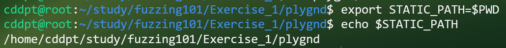
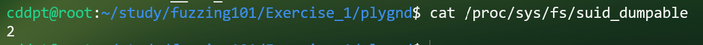
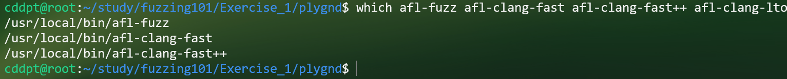
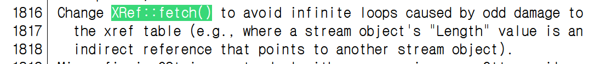
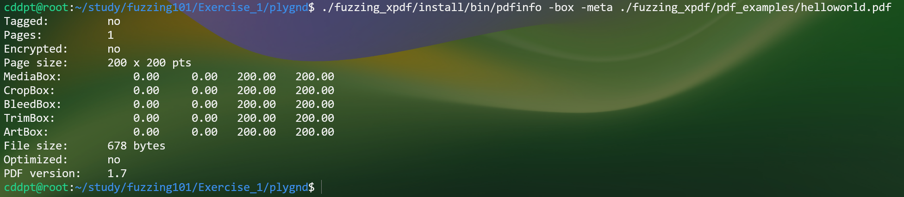
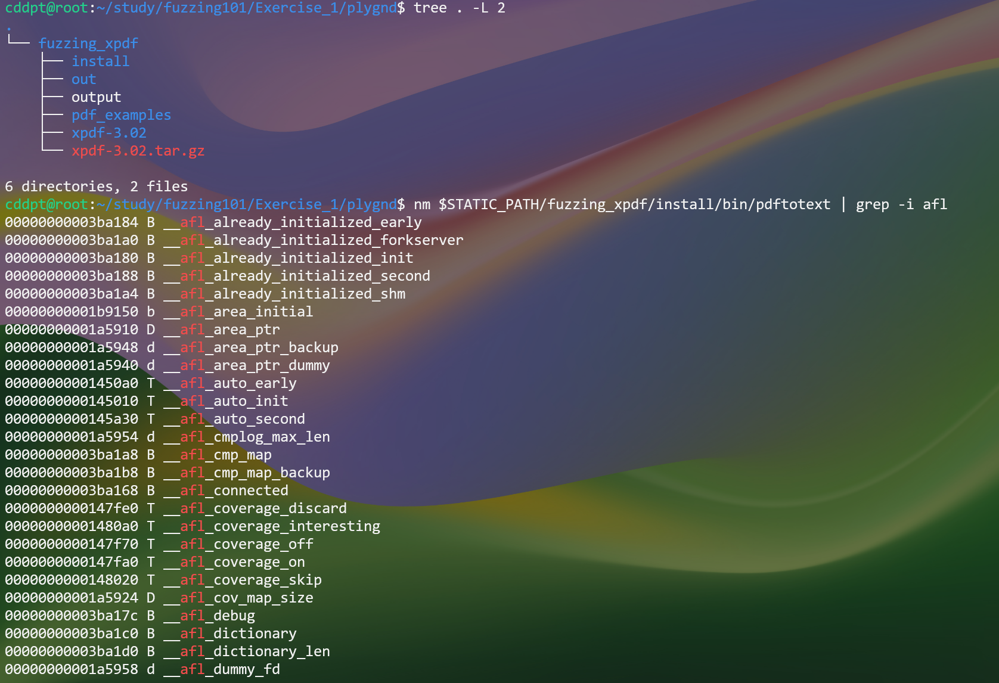
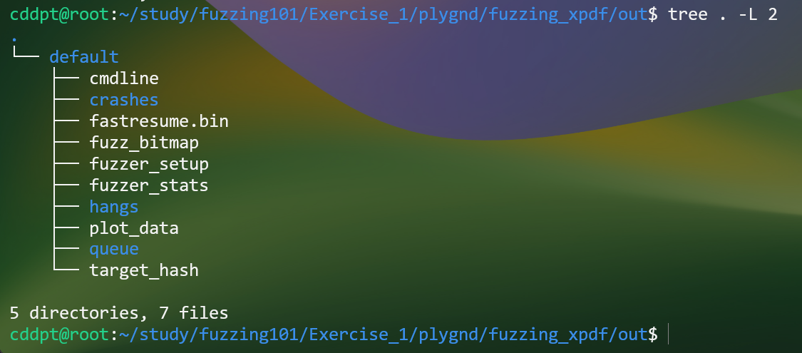
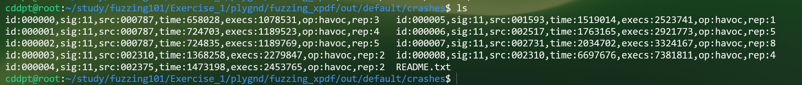
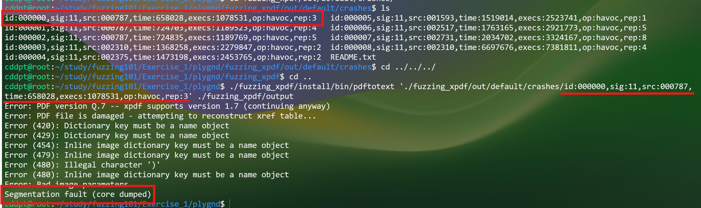

# Fuzzing101 Exercise_1

Enviroment: Ubuntu 24.04 server LTS (connect as SSH), AFL++ 4.36a

Github : [https://github.com/antonio-morales/Fuzzing101/tree/main/Exercise%201](https://github.com/antonio-morales/Fuzzing101/tree/main/Exercise%201)

# 1. 환경 설정

## 1-1. `STATIC_PATH` 지정

Exercise마다 작업 디렉터리가 다르므로 `~/.bashrc` 에 박아두지 말고, 실습 디렉터리에서 그때그때 지정한다.

```bash
cd ~/study/Fuzzing101/Exercise_1/plygnd
export STATIC_PATH=$PWD
echo $STATIC_PATH
```



- `export` 없이 `STATIC_PATH=$PWD` 만 해도 같은 셸 안에서는 확장되지만, `export` 를 붙여야 서브셸/자식 프로세스에서도 유효하다.
- 처음엔 `$PWD` 를 그대로 쓰려 했으나, `cd` 할 때마다 값이 바뀌어 문서 중간에 디렉터리 이동이 섞이면 경로가 꼬인다. 그래서 **한 번 고정해두는 `$STATIC_PATH`** 방식으로 전환했다.

## 1-2. `core_pattern` 설정

이걸 안 하면 퍼징 시작 시 `PROGRAM ABORT : Pipe at the beginning of 'core_pattern'` 로 즉시 중단된다.
시스템이 코어 덤프를 외부 유틸리티로 넘기도록 돼 있어, 크래시가 타임아웃으로 오인되기 때문이다.

```bash
cat /proc/sys/fs/suid_dumpable            # 현재 값 확인 => 0 (비활성화), 1 (디버그용 활성화), 2 (보안 모드로 활성화)
echo core | sudo tee /proc/sys/kernel/core_pattern
# or echo "2" | sudo tee /proc/sys/fs/suid_dumpable
```



> suid_dumpable은 권한이 변경된 프로그램(SetUID)이 죽었을 때 코어 덤프를 남길지 결정하는 플래그 번호이다

> `sudo su` 후 `echo core > /proc/sys/kernel/core_pattern` 는 리다이렉션이 **원래 셸 권한**으로 평가돼
> Permission denied 가 난다. 반드시 `sudo tee` 를 쓸 것.
>
> **재부팅하면 초기화된다.** 영구 적용하려면 `/etc/sysctl.d/99-afl.conf` 에 `kernel.core_pattern=core` 추가.

## 1-3. AFL 컴파일러 확인

```bash
which afl-fuzz afl-clang-fast afl-clang-fast++ afl-clang-lto
```



# 2. 이번 퍼징의 목표

- AFL compiler를 이용해 컴파일을 진행
- afl-fuzz 를 이용해 퍼징을 진행
- gdb로 발생한 crash를 분류하고 취약점을 특정

## 2-1. 퍼징 대상과 입력 파일

```text
target binary = Xpdf-3.02 
input seed = 123
```

타겟을 Xpdf-3.02를 하는 이유는 CVE-2019-13288이 패치되기 직전 버전이 3.02 이고 3.03에서 패치가 되었기 때문이다.
패치버전과 취약버전을 직접적으로 구분하기 좋다고 생각되어 Xpdf-3.02를 선택한다.

input seed는 보통 정상적으로 동작을 하는 파일을 넣는 것이 일반적이지만 초기 상태부터 크래시를 만들 수 있다는 것을 증명하기 위해 123으로 넣었다


https://sources.debian.org/src/xpdf/3.03-10/CHANGES


# 3. 대상 CVE: CVE-2019-13288

## 3-1. CVE 개요

CVE-2019-13288은 특수하게 조작된 파일을 통해 무한 재귀를 유발할 수 있는 취약점이다.

프로그램에서 호출되는 각 함수는 스택에 stack frame을 할당하기 때문에, 함수가 너무 많이 재귀 호출되면 스택 메모리가 고갈되어 프로그램이 중단될 수 있다.
결과적으로, Attacker는 이를 악용하여 DoS 공격을 수행할 수 있다.

`Parser::getObj()`에서 무한 재귀가 발생해 DoS가 일어나는 것이다.

# 4. 계측 빌드 준비 및 일반 빌드

Exercise_1은 빌드를 두 번 한다.

1. **일반 빌드** — 타깃이 정상 동작하는지 확인용
2. **AFL 컴파일러로 재빌드** — 퍼징용

2단계를 건너뛰면 퍼징 시작 시 `PROGRAM ABORT : No instrumentation detected` 가 뜬다.
AFL이 커버리지 피드백을 읽으려면 컴파일 시점에 계측이 들어가 있어야 하기 때문이다.

## 4-1. 초기 빌드

```bash
# making directory for fuzzing
cd $STATIC_PATH
mkdir fuzzing_xpdf && cd fuzzing_xpdf/

# you may need to install some additional tools (namely make and gcc)
sudo apt install build-essential

# Download and build Xpdf 3.02
wget https://dl.xpdfreader.com/old/xpdf-3.02.tar.gz
tar -xvzf xpdf-3.02.tar.gz

cd xpdf-3.02
sudo apt update && sudo apt install -y build-essential gcc
./configure --prefix="$STATIC_PATH/fuzzing_xpdf/install/"
make
make install
```

## 4-2. 일반 빌드 동작 확인

```bash
$STATIC_PATH/fuzzing_xpdf/install/bin/pdfinfo -box -meta /path/to/example/pdf
```




# 5. AFL 계측 재빌드

afl로 fuzzing을 하기 위해서는 afl-fuzz에서 제공하는 컴파일러로 다시 빌드를 해야한다.


```bash
rm -rf $STATIC_PATH/fuzzing_xpdf/install
cd $STATIC_PATH/fuzzing_xpdf/xpdf-3.02/
make clean

CC=afl-clang-fast CXX=afl-clang-fast++ \
  ./configure --prefix="$STATIC_PATH/fuzzing_xpdf/install/"
make
make install
```

빌드는 시간이 걸리므로 tmux 세션 안에서 돌리고, 필요하면 detach 로 분리해두면 된다.

# 6. AFL 계측 빌드 검증

- `configure` 출력에서 컴파일러가 `afl-clang-fast` 로 잡히는지
- `make` 로그에 `Instrumented N locations` 류의 줄이 뜨는지
- 빌드 완료 후:

```bash
nm $STATIC_PATH/fuzzing_xpdf/install/bin/pdftotext | grep -i afl
# AFL 심볼이 나와야 정상. 아무것도 안 나오면 계측 실패
```


# 7. 퍼징 실행

이전 실패 시도로 `out/` 에 깨진 세션이 남아 있을 수 있으므로 지우고 시작한다.

```bash
rm -rf $STATIC_PATH/fuzzing_xpdf/out

afl-fuzz -i $STATIC_PATH/fuzzing_xpdf/pdf_examples/ \
         -o $STATIC_PATH/fuzzing_xpdf/out/ \
         -s 123 \
         -- $STATIC_PATH/fuzzing_xpdf/install/bin/pdftotext @@ $STATIC_PATH/fuzzing_xpdf/output
```

fuzzing자체는 tmux로 진행하는게 나을 수 있다.

화면이 뜨면 `Ctrl+b` → `d` 로 분리하고 SSH를 끊어도 된다.
크래시 파일 위치: `$STATIC_PATH/fuzzing_xpdf/out/default/crashes/`



# 8. 크래시 결과 확인


## 8-1. AFL 크래시 결과와 입력 파일 확인


## 8-2. 분석할 크래시 선정

```bash
 $STATIC_PATH/fuzzing_xpdf/install/bin/pdftotext '$STATIC_PATH/fuzzing_xpdf/out/default/crashes/<your_crash_id>' $STATIC_PATH/fuzzing_xpdf/output
```



crash는 제일 처음에 나타난 것으로 했다.

다시 pdftotext로 crash가 난 파일을 돌려보면 `Segmentation Fault` 가 뜨는 것을 확인 할 수 있다.

# 9. GDB로 크래시 재현 및 실행 흐름 추적 (Triage)

## 9-1. GDB로 크래시 재현


## 9-2. 크래시까지의 호출 흐름 추적

# 10. 취약 코드와 패치 분석

## 10-1. 취약 코드 확인

## 10-2. 근본 원인 분석

## 10-3. 패치 방식 확인

## 10-4. 패치 후 동작 확인

# 11. 분석 소감

# 12. 참고

## 12-1. CVE 참고 자료

- https://www.cvedetails.com/cve/CVE-2019-13288/
- https://cwe.mitre.org/data/definitions/674.html
- https://nvd.nist.gov/vuln/detail/cve-2019-13288
- https://strobes.co/vi/cve/CVE-2019-13288/

## 12-2. 실행 전 체크리스트

- [ ] `tmux new -s fuzz` 또는 `tmux attach -t fuzz` — **먼저 세션 안으로**
- [ ] `export STATIC_PATH=$PWD` — tmux 세션 안의 셸에서
- [ ] `cat /proc/sys/kernel/core_pattern` → `core` (재부팅했다면 다시)
- [ ] `nm <타깃바이너리> | grep -i afl` → 심볼 존재
- [ ] 이전 `out/` 디렉터리 정리
- [ ] 환경변수는 명령 **앞**에 배치

## 12-3. tmux 운용

### 12-3-1. 자주 쓰는 키

모두 **prefix(`Ctrl+b`)를 먼저 누르고 뗀 뒤** 해당 키를 누른다.

| 키 | 동작 |
|---|---|
| `d` | detach (세션은 계속 실행) |
| `[` | 스크롤 모드 진입 (`q` 로 나감) |
| `c` | 새 창 생성 |
| `n` / `p` | 다음 / 이전 창 |
| `0`~`9` | 번호로 창 이동 |
| `"` | 가로 분할 |
| `%` | 세로 분할 |
| `방향키` | 분할된 pane 간 이동 |
| `&` | 현재 창 종료 |

AFL 화면은 자체 갱신되므로 마우스 휠이 안 먹는다. 로그를 거슬러 보려면 `Ctrl+b` → `[` 로
스크롤 모드에 들어간 뒤 방향키/PageUp을 쓴다.

### 12-3-2. 창 분할해서 모니터링

퍼징 화면은 그대로 두고 다른 pane에서 상태를 확인할 수 있다.

```bash
# Ctrl+b " 로 가로 분할한 뒤, 아래쪽 pane에서
watch -n 5 afl-whatsup $STATIC_PATH/fuzzing_xpdf/out/

# 또는 크래시 개수만 계속 확인
watch -n 10 'ls $STATIC_PATH/fuzzing_xpdf/out/default/crashes/ | wc -l'
```

새로 만든 pane은 별도 셸이므로 `export STATIC_PATH=...` 를 다시 해줘야 한다.

### 12-3-3. 세션 정리

```bash
tmux kill-session -t fuzz   # 특정 세션 종료
tmux kill-server            # 전체 종료
```

퍼징을 멈추려면 attach 한 뒤 `Ctrl+c` 로 afl-fuzz 를 먼저 끄고 세션을 정리하는 편이 안전하다.
`out/` 디렉터리 상태가 깔끔하게 남는다.

### 12-3-4. 편의 설정 (선택)

`~/.tmux.conf`:

```
set -g mouse on              # 마우스 스크롤/pane 선택 허용
set -g history-limit 50000   # 스크롤백 늘리기
set -g status-bg colour235
```

적용: `tmux source-file ~/.tmux.conf` (또는 새 세션부터 반영)

> `screen` 을 이미 쓰고 있다면 `screen -S fuzz` → `Ctrl+a d` 로 detach, `screen -r fuzz` 로 재접속.
> 굳이 바꿀 필요는 없다.
